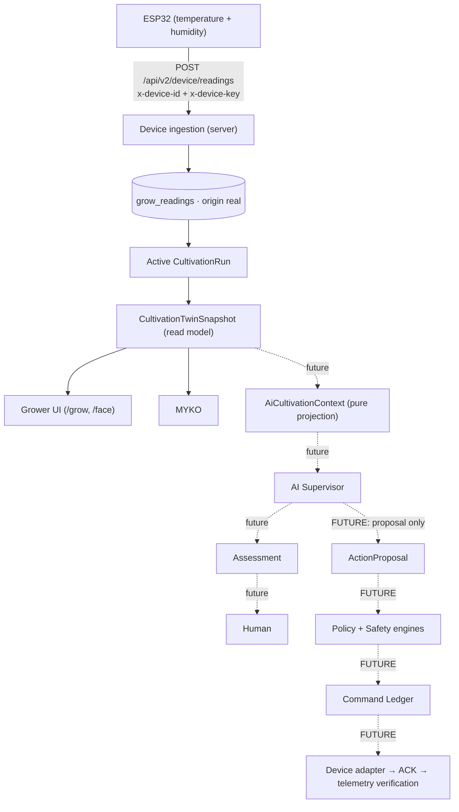

# MYKOSPHARE 2.0 — Organism-agnostic domain + Real cultivation loop v1

```text
PHYSICAL ORGANISM → SENSORS / CAMERA → OBSERVATIONS → DIGITAL TWIN
  → DETERMINISTIC STATE → MYKO → (future) AI SUPERVISOR → HUMAN → (future) SAFE CONTROL
```

MYKO is the living interface of the twin, not its source of truth. AI is not a
source of truth either. **Physical observations and the human-confirmed
cultivation state are.**



## A. Organism-agnostic domain (generalize capabilities, not everything)

- **Stages are profile-driven.** `StageId` is a string declared by the
  organism profile (`SpeciesProfile.stages`: ordered `{ id, label?, mykoForm,
  suggestFromDay? }`). The DB columns `confirmed_stage` / `grow_stage_events.stage`
  are now text validated against the run's profile (migration `202610010001`).
- **`SpeciesProfile` keeps its name.** Renaming to `OrganismProfile` would churn
  the DB adapter, UI and tests for no behavioural gain. The organism seam is the
  optional `organismKind`, `morphology`, `stages`, `capabilities`.
- **Targets: hybrid.** Temperature/humidity stay typed (Pleurotus unchanged);
  future metrics live in `StageTargets.metrics`, keyed by the capability
  vocabulary — no free-form JSON, no column per imaginable sensor.
- Not generalized on purpose: `EnvironmentalReading` (still temperature +
  humidity, the only real hardware), evaluation rules (only real metrics are
  evaluated), needs vocabulary, MYKO anatomy.

## B. Pleurotus is the first implementation

A profile without `stages` uses `FUNGAL_STAGE_DEFINITIONS` (inoculation →
colonization → consolidation → primordia → fruiting → harvest, same day
suggestions and MYKO mapping as before). A synthetic flowering-plant profile
exists **only as a test fixture** to prove nothing is mushroom-locked.

## C. Digital twin read model

`CultivationTwinSnapshot` (`lib/grow/twin.ts`) is a pure projection:

| Field | Content |
|---|---|
| `mode` | `real` \| `simulation` (explicit) |
| `run` | the run record (status, confirmed stage) |
| `profile`, `organism` | kind, morphology, ordered stages |
| `stage` | confirmed (id, confirmedAt, provenance) · suggested (deterministic, never a confirmation) · position |
| `latestObservation` | latest reading + provenance |
| `freshness`, `capabilities` | see D |
| `grow` | the existing `GrowSnapshot` (GrowState + MYKO), composed, not duplicated |
| `memory` | bounded: readings (24 h, ≤ 288), events (≤ 20), stage history (≤ 12), latest capture |

`getCultivationTwin()` builds it from the repository; `GET /api/v2/grow/[chamberId]`
returns it (minus the capture storage path). Real mode never falls back to
simulation; simulation carries no persisted memory.

## D. Capabilities

Four different questions (`lib/grow/capabilities.ts`): **supported** by the
profile · **installed** on the chamber (`grow_devices.capabilities`) ·
**available** (installed and reporting) · **observed** (value in the latest
reading). Unavailable or unobserved is `null`, never `0`. Vocabulary:
`temperature, humidity, co2, light, substrate_moisture, ph, ec, mass, vision`.
MYKO's body senses still use the presentation registry; deriving them from
`twin.capabilities` is the next small step.

## E. Provenance

`Provenance = sensor | simulation | manual | vision_model | ai_supervisor | deterministic`.
Readings: `real → sensor`, `simulated → simulation`. Stage confirmation:
`manual` only (type-enforced; the DB check allows only `manual` for stage
events). Suggestions: `deterministic`. AI output is always `ai_supervisor` and
can never be stored as an observation.

## F. Real ingestion loop

```
POST /api/v2/device/readings
x-device-id:  esp32-box-1          ← grow_devices.hardware_identifier
x-device-key: myk_…                ← issued once; only its SHA-256 is stored
Content-Type: application/json

{ "temperature": 22.4, "humidity": 71.2 }                       // device without clock
{ "observedAt": "2026-10-01T12:00:00Z", "temperature": 22.4, "humidity": 71.2 }  // with NTP
```

Responses: `201 {accepted, runAttached, observedAt}` · `200 {duplicate:true}` ·
`401` unknown device or wrong key (indistinguishable) · `403` disabled device ·
`400` invalid body (unknown fields such as `origin`, `chamberId`, `runId`, `co2`
are rejected) · `413` > 8 KB · `503` storage unavailable.

The chamber and active run are resolved **from the device record**. Without an
active run the reading is still kept for the chamber (`runAttached: false`).
Without `observedAt`, the server stamps receipt time and records
`metadata.clock = "server"`. Retries are idempotent by `(device_id, observed_at, origin)`.

Credentials: `grow_device_credentials` (several per device → rotation; `revoked`
status; no RLS policy → service role only, the browser can never read them).

## G. Cultivation lifecycle

`active → completed` (the existing `aborted` status is untouched). Application
operations (`lib/grow/application/lifecycle.ts`), exposed to the signed-in owner:

| Route | Operation |
|---|---|
| `POST /api/v2/grow/runs` `{chamberId, profileId, initialStage?, name?}` | `startCultivation` — stage event + `cultivation_started` |
| `POST /api/v2/grow/runs/:runId/stage` `{stage}` | `confirmCultivationStage(source: manual)` — idempotent, forward-only |
| `POST /api/v2/grow/runs/:runId/complete` `{finalStage?, yieldGrams?, notes?}` | `completeCultivation` — `harvest_confirmed`, only entered facts |

Ownership is resolved server-side; one active run per chamber is the DB's
partial unique index (surfaced as `409 active_run_exists`). Browser sessions can
only READ runs/events/captures (RLS); writes go through these routes.

## H. Camera seam

`grow_captures` already models `run_id, device_id, storage_path, captured_at,
origin`. The twin exposes `latestCapture` metadata and derives `vision`
availability from capture recency. The Poco C75 → Storage `snapshots` uploads
are **not yet linked** to `grow_captures`/runs; no image is interpreted.

## I. AI Supervisor seam (no model is called)

`projectAiCultivationContext(twin)` (`lib/grow/ai/context.ts`) is an
allow-listed, pure projection. It contains: organism (names, kind, profile
validation) · confirmed and suggested stage + declared stages · cultivation
day · freshness · health · data status · installed observations with value or
`null`, unit, timestamp, provenance and evidence ref · missing capabilities
(not installed / not reporting) · stage targets · needs · 24 h min/max/first/last
trend · recent events · latest capture time. It never contains credentials,
key hashes, device hardware ids, owner/user ids, storage paths or DB rows.

Output contracts (`lib/grow/ai/contracts.ts`, types only): `AiSupervisorAssessment`
(claims with evidence refs) and `AiActionProposal` (inert, `status: "proposed"`,
`requiresHumanApproval: true`). Assessment ≠ proposal ≠ device command ≠
confirmed execution.

## J. Future safe control (NOT implemented)

> **AI NEVER WRITES GPIO.**

`AI Supervisor → ActionProposal → Policy Engine → Safety Engine → Command
Ledger → Device Adapter → ACK → Telemetry verification`. None of these stages
after the proposal exists; `/api/command` (1.x) is untouched and unrelated.

## K. What remains simulated / future

Simulation mode (`?mode=simulation`, demo scenarios) · stage day suggestions
(heuristic) · environment transition events (`deriveEnvironmentTransition` is
pure and tested, not yet wired to ingestion) · camera linkage · CV · AI ·
control · per-run yield analytics · sensors beyond temperature/humidity.

## L. What is real today (after this milestone, once the migration is applied)

Per-device authenticated ingestion of temperature/humidity · persisted readings
attached to the active run · start / confirm stage / complete with persisted
events and manual provenance · the twin built from persisted data · freshness ·
MYKO driven by that twin.

---

## Connecting the current physical ESP32

Nothing below has been executed against production. Order matters.

1. **Apply the migration** `supabase/migrations/202610010001_grow_cultivation_loop.sql`
   (after `202609300001`) to the Supabase project.
2. **Create a chamber** (SQL editor; your auth user id):
   ```sql
   insert into public.grow_chambers (owner_id, name, display_code)
   values ('<your-auth-user-uuid>', 'Caja 1', 'BOX1') returning id;
   ```
3. **Register the ESP32** with what it really has installed:
   ```sql
   insert into public.grow_devices (chamber_id, device_type, name, hardware_identifier, capabilities)
   values ('<chamber-id>', 'controller', 'ESP32 caja 1', 'esp32-box-1', array['temperature','humidity'])
   returning id;
   ```
4. **Issue a device key** locally (prints the key once; store only hash + hint):
   ```bash
   node -e "const c=require('crypto');const k='myk_'+c.randomBytes(32).toString('base64url');console.log('KEY ',k);console.log('HASH',c.createHash('sha256').update(k).digest('hex'));console.log('HINT',k.slice(0,10))"
   ```
   ```sql
   insert into public.grow_device_credentials (device_id, key_hash, key_hint)
   values ('<device-id>', '<HASH>', '<HINT>');
   ```
5. **Start the cultivation** while signed in (browser devtools on the app origin):
   ```js
   await fetch("/api/v2/grow/runs", { method: "POST", headers: { "Content-Type": "application/json" },
     body: JSON.stringify({ chamberId: "<chamber-id>", profileId: "<pleurotus-profile-id>", initialStage: "colonization" }) }).then(r => r.json())
   ```
   (`select id from grow_species_profiles where species = 'Pleurotus ostreatus';`)
6. **Firmware change** (the current firmware posts `{temp, hum}` unauthenticated to
   the legacy `/api/data`; its production source is not in this repository). The
   v2 request, as an Arduino sketch fragment — **not compiled or flashed here**:
   ```cpp
   #include <WiFiClientSecure.h>
   #include <HTTPClient.h>
   const char* URL = "https://<your-app-host>/api/v2/device/readings";
   const char* DEVICE_ID = "esp32-box-1";
   const char* DEVICE_KEY = "myk_...";   // keep out of version control

   void postReading(float t, float h) {
     WiFiClientSecure client;
     client.setCACert(ROOT_CA_PEM);       // pin the host's root CA; avoid setInsecure()
     HTTPClient http;
     http.begin(client, URL);
     http.addHeader("Content-Type", "application/json");
     http.addHeader("x-device-id", DEVICE_ID);
     http.addHeader("x-device-key", DEVICE_KEY);
     String body = String("{\"temperature\":") + String(t, 1) + ",\"humidity\":" + String(h, 1) + "}";
     int code = http.POST(body);          // 201 accepted · 200 duplicate · 401/403 credentials
     http.end();
   }
   ```
   Add `observedAt` only if the board has synced NTP; otherwise the server stamps it.
7. **Verify**: `/grow?chamber=<chamber-id>` shows REAL data with freshness `live`.

## Remaining hardening (documented debt)

- Lifecycle writes are sequential service-role calls, not one transaction (an
  RPC would make start/confirm/complete atomic).
- No rate limiting on device ingestion; no replay nonce/signature (TLS + secret
  key only); no device self-rotation endpoint (rotation = issue + revoke in SQL).
- No UI to register devices / issue keys / start runs (API + SQL only).
- Environment transition events are not yet written by ingestion.
- Captures are not yet linked from the Poco C75 pipeline.
- Readings retention/downsampling remain deferred (the twin bounds its reads).
- DB types are handwritten adapters pending generated Supabase types.
